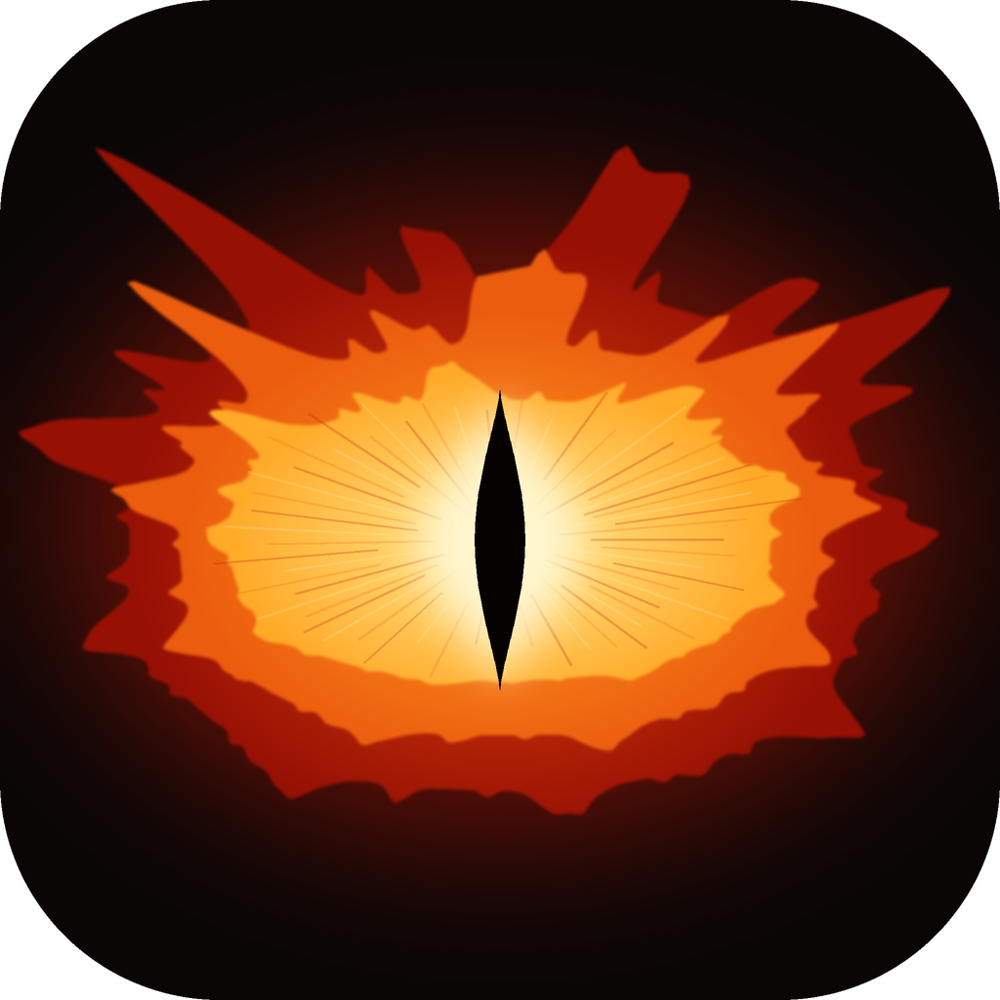

<p align="center"></p>

<h1 align="center">Eye of SaurCom</h1>

<p align="center"><b><i>One eye. Every band. It sees what is on the air.</i></b></p>

<p align="center">A software-defined radio suite that watches the whole spectrum: 145 receive modes, transmit, trunking, streaming, ATAK and mesh messaging, all in one program on your own computer.<br>
Free and open source (GPL-3.0), for macOS, Windows, Linux and Android.</p>

<p align="center">
  <a href="https://github.com/AxolDad/Eye_of_SaurCom/actions/workflows/ci.yml"></a>
  
  <a href="LICENSE"></a>
</p>

<p align="center">
  <a href="#what-this-fork-adds"><b>What it adds</b></a> &nbsp;·&nbsp;
  <a href="#build-from-source"><b>Build</b></a> &nbsp;·&nbsp;
  <a href="docs/"><b>Docs</b></a> &nbsp;·&nbsp;
  <a href="#videos"><b>Videos</b></a>
</p>

---

<div align="center">

<table>
<tr>
<td align="center" width="33%"><a href="docs/img/main.jpg"></a><br><sub>Spectrum, waterfall and DVB-T constellations</sub></td>
<td align="center" width="33%"><a href="docs/img/adsb.jpg"></a><br><sub>ADS-B aircraft map</sub></td>
<td align="center" width="33%"><a href="docs/img/dab.jpg"></a><br><sub>DAB+ ensemble</sub></td>
</tr>
<tr>
<td align="center" width="33%"><a href="docs/img/fm.jpg"></a><br><sub>FM with RDS and Listen</sub></td>
<td align="center" width="33%"><a href="docs/img/ais.jpg"></a><br><sub>AIS ships on the map</sub></td>
<td align="center" width="33%"><a href="docs/img/touch.jpg"></a><br><sub>Touch interface</sub></td>
</tr>
</table>

<sub>Screenshots use the built-in test signals and demo data, so no radio is shown. They were taken before the rename. Click one to enlarge.</sub>

</div>

Eye of SaurCom turns a low-cost SDR (a HackRF, an RTL-SDR, an Airspy and many other radios) into one station for most of what is on the air. Plug in an antenna, pick a mode, and see everything inside the signal: the spectrum, the sync, the error correction and the decoded data. Aircraft, ships, satellites, broadcast TV and radio, trunked two-way radio, pagers, sensors and mesh networks all show up in the same place, on the same map.

It started as a fork of [OnAir](https://github.com/adswill/OnAir), Kristijonas Adomaitis's receiver, and keeps all of its decoders. On top of that it **talks back**: it transmits, follows trunked systems, streams what it hears, hands positions to ATAK, and sends mesh messages. See [What this fork adds](#what-this-fork-adds).

**Your station, your data.** Everything runs on your own computer. There are no accounts and no cloud service of the project's own. The program only goes on the network for things you turn on (a feed, a stream, map tiles, an update check), and decodes every aircraft and signal it receives the same way.

> **About the name:** yes, it is a nod to a certain lidless eye on a dark tower. This one only watches the airwaves, and it reports to you alone.

> [!TIP]
> New here? Choose **Help > Get me listening**, pick *Synthetic test signal* and then *FM broadcast*: you hear something within a minute, with no radio. **Help > Guided tours** then walks you through the window.

## Contents

- [What it does](#what-it-does) · [What this fork adds](#what-this-fork-adds) · [Videos](#videos)
- [Install](#install) · [Android app](#android-app) · [Development version](#development-version-nightly)
- [Quick start](#quick-start)
- [Modes](#modes) · [Tools and notes](#tools-and-notes)
- [Features](#features)
- [Supported radios](#supported-radios) · [Network radios](#network-radios)
- [Transmit](#transmit)
- [Remote-control API](#remote-control-api)
- [Updates](#updates)
- [Good to know](#good-to-know) · [Troubleshooting](#troubleshooting)
- [Build from source](#build-from-source)
- [Community](#community) · [Credits](#credits) · [Contributors](#contributors) · [License](#license)

## What it does

| Family | What you get |
|---|---|
| **TV** | DVB-T/T2, DVB-S/S2/S2X, a TV satellite beacon decoder, DVB-C, ATSC 1.0 and 3.0, ISDB-T, DTMB, analogue TV and MAC, analog FPV video (5.8 / 1.2 GHz), with a live player (picture, sound, subtitles, teletext, programme guide), recording, pause and live buffer, and 2-3 adjacent channels from one wide capture |
| **Broadcast radio** | DAB+ (with a programme guide), DRM (with its data services), HD Radio, CDR, AM broadcast (medium wave and shortwave), AM stereo (C-QUAM), and FM with RDS, a Mono switch for weak stations and a saved-station library |
| **Aviation** | ADS-B with a live map, Mode A/C squawks and altitudes, UAT (with FIS-B weather, NOTAMs and TFRs), ACARS, VDL2 and VDL4, HFDL, airband, VOR / ILS / NDB, FLARM, drones; NOTAMs and TFRs from the FAA as well, and a flight history |
| **Maritime** | AIS, VDES, NAVTEX, DSC, weather fax |
| **Satellite and navigation** | Weather pictures from Meteor, GOES, Elektro-L and MetOp, Iridium, Inmarsat, Orbcomm, QO-100, CubeSat telemetry, GNSS, COSPAS-SARSAT 406 MHz distress beacons, GOES / Meteosat DCS platform reports |
| **Two-way radio** | DMR, P25 (with a trunking follower), NXDN, dPMR, D-STAR, M17, TETRA, TETRAPOL, tone decoders (CTCSS, DCS, DTMF, selcall) |
| **Cellular and rail** | LTE, 5G NR and NB-IoT cells, GSM-R, LBJ, KLW, TDCS |
| **Pagers** | POCSAG, FLEX, Multitone |
| **IoT and sensors** | ISM sensors, NFC / RFID sniffer, LoRaWAN, Meshtastic, MeshCore, Bluetooth LE, BLE tracker detector, Zigbee, Wi-Fi, Wi-SUN, Wireless M-Bus, Z-Wave, DECT, ANT+ |
| **Amateur** | FT8, FT4, WSPR, JS8Call, RTTY, PSK, MT63, FSQ, IFKP, ARDOP, SSTV, FreeDV, APRS, LoRa APRS, MeshCom and more |
| **Weather and science** | Radiosondes, HRPT, SAME alerts, time signals, e-Czas, ionospheric sounders, radio astronomy, meteor scatter |
| **HF utility** | ALE, beacons, Datawell buoys, CODAR |
| **Tools** | General receiver, spectrum analyser, spectrum explorer, signal workbench; also a gain optimiser, a direction finder, a pass planner and a remote-control API |

**Many radios:** HackRF, RTL-SDR, Airspy, SDRplay, BladeRF, LimeSDR, USRP, Pluto, Fobos, RX888, RFNM, network radios, sound cards and Hamlib rigs. Details per mode are under [Modes](#modes).

## What this fork adds

Everything above came from OnAir. This is what Eye of SaurCom built on top of it. Most of it has been tested on generated signals and recordings; a few parts say *experimental* in the app.

**Seeing it all**

- **The Eye** (*Tools > The Eye*, Ctrl+E): everything the station decodes, from every mode, in one window. Live counts per kind of contact, a scope that places every aircraft, ship, APRS station, sonde and drone by bearing and distance from you, and one timeline of first sightings and messages. [docs/eye.md](docs/eye.md)

**Talking back**

- **Transmit, unlocked.** Every mode with a signal generator can be sent through a radio that transmits. A one-time agreement ("I will transmit only within my legal authority") turns it on; after that there are no band, power or mode locks, and **TX ON AIR** stays in the top bar while you are on the air. See [Transmit](#transmit).
- **Mesh send.** Meshtastic and MeshCore text and position go out through the SDR, not only in.
- **ATAK / TAK bridge.** Aircraft, ships, APRS stations and radiosondes go out as Cursor on Target over UDP (the 239.2.3.1:6969 group ATAK and WinTAK listen on, or a TAK server), and TAK contacts show on the map. *Tools > Data feeds*.

**Listening wider**

- **Trunking and scanning.** P25, DMR Tier III and NXDN Type C call following, several trunked systems scanned with conventional channels in one list, talkgroup names and call recording. sdrtrunk is the reference. [docs/trunking.md](docs/trunking.md), [docs/scanner.md](docs/scanner.md)
- **Synchronous AM and a co-channel canceller** in the General receiver: SAM locks the station's own carrier so fading no longer distorts it, and the canceller rebuilds the near station and subtracts it so the one underneath comes up.
- **NFC / RFID sniffer** at 13.56 MHz, from nfc-laboratory's decoder. [docs/nfc.md](docs/nfc.md)
- **Inmarsat-C:** EGC areas, the land-earth-station list, announcements and messages to ships.
- **WiFi sensing.** Presence, motion, breathing and heart rate per room, from the CSI frames that [RuView](https://github.com/ruvnet/RuView)'s ESP32 firmware sends. *Tools > WiFi sensing*.

**Aviation**

- **NOTAMs and TFRs** that fall back to the most accurate source available: the FAA NOTAM API, then tfr.faa.gov, then FIS-B off the air from UAT 978. TFRs are drawn on the ADS-B map. [docs/notams.md](docs/notams.md)
- **Flight history.** Flights cut into phases (ground, take-off, climb, cruise, descent, approach, landing), tracks, per-aircraft dossiers and pattern questions, kept in a local database, with the OurAirports runways. [docs/flight-history.md](docs/flight-history.md)
- **ADS-B networks both ways:** feed presets for the aggregators, and asking a service what is in the air near you. [docs/adsb-services.md](docs/adsb-services.md)
- **Better transcripts:** the audio is cleaned up before the speech engine hears it, and the engine is told what is on the air (the call signs in range, nearby runways and airports, the talkgroups you follow). [docs/TRANSCRIBE.md](docs/TRANSCRIBE.md)

**Out to the world**

- **Audio out and Icecast.** The sound you hear goes to any output device (a virtual cable included) or as MP3 to an Icecast server.
- **Internet radio** (*Tools > Internet radio*): search the radio-browser.info directory and play a station through the same sound output, so recording, streaming and virtual cables get it too.
- **Video out:** the **Stream** button next to the analog TV and FPV pictures sends them as MPEG-2 in a transport stream over UDP, to one computer or a multicast group; VLC opens it.

**Tools and radios**

- **Radio tools** (*Tools > Radio tools*): Wi-Fi deauthentication flood and evil-twin alarms, a list of Bluetooth names used by card skimmers, a frequency analyzer with sub-GHz presets, and a drive log of Wi-Fi and Bluetooth with GPS to a WiGLE CSV or KML file. Receive only: nothing joins, pairs or transmits.
- **Deep Space Network** (*Tools > Deep Space Network*): what NASA's dishes at Goldstone, Madrid and Canberra are talking to right now, with a Tune button when a downlink frequency is published.
- **New radios and files:** Aaronia Spectran V6 through RTSA-Suite ([docs/NETWORK_RADIOS.md](docs/NETWORK_RADIOS.md)), ESP32 boards as radios ([docs/esp-sdr.md](docs/esp-sdr.md)), and Flipper Zero `.sub` captures in and out of the ISM sensor mode.

**Taken out:** the features that depended on servers run by the upstream project (the shared map, live rooms, the update mirror, the shared DAB transmitter list and the online channel database). Updates now come only from this repository's GitHub releases.

The plan this grew from: [design](docs/superpowers/specs/2026-10-23-eye-of-saurcom-design.md). OnAir's own release notes up to 0.2.8: [docs/ONAIR-HISTORY.md](docs/ONAIR-HISTORY.md).

## Videos

Short how-tos, in [video/renders](video/renders). They were recorded under the earlier working name, ZorCom.

| | |
|---|---|
| [Overview](video/renders/01-overview.mp4) | [Getting started](video/renders/02-getting-started.mp4) |
| [Trunking](video/renders/03-trunking.mp4) | [ATAK](video/renders/04-atak.mp4) |
| [WiFi sensing](video/renders/05-wifi-sensing.mp4) | [Transmit and mesh](video/renders/06-transmit-mesh.mp4) |
| [Audio and internet radio](video/renders/07-audio-radio.mp4) | |

## Install

> [!NOTE]
> **0.3.0 has macOS, Linux and Docker.** The Windows installer and the Android APK are not built for this fork yet; on Windows, [build from source](#build-from-source) for now.

Download the file for your system from the **[latest release](https://github.com/AxolDad/Eye_of_SaurCom/releases/latest)**. There is nothing to compile.

| System | Download | How to install |
|---|---|---|
| **macOS** 15 or later | `SaurCom-…-macos-arm64.dmg` (Apple silicon)<br>`SaurCom-…-macos-x86_64.dmg` (Intel) | Open the `.dmg` and drag Eye of SaurCom to Applications. The app is not signed with a developer certificate yet, so on the first launch right-click it and choose *Open*. Intel Macs need a CPU with AVX2 (2013 or newer). |
| **Windows** 10 / 11, 64-bit | *not in 0.3.0 yet:* `SaurCom-…-windows-x64-setup.exe`<br>or `SaurCom-…-windows-x64.zip` | Run the installer, or unpack the zip and start `SaurCom.exe`. Windows may warn about an unknown publisher because the installer is not code-signed. Needs a CPU with AVX2 (Intel or AMD from about 2013 on). |
| **Linux** x86-64 and arm64 | `saurcom_…_amd64.deb` / `saurcom_…_arm64.deb`<br>or `saurcom-…-portable.tar.gz` | Debian / Ubuntu: `sudo apt install ./saurcom_<version>_<arch>.deb`, then start Eye of SaurCom from the menu or with `saurcom`. The `.deb` carries its own video decoder, so it does not depend on your system's FFmpeg. Other distributions: unpack the portable archive and run `bin/saurcom`. |
| **Android** 9+, arm64 | *not in 0.3.0 yet:* `SaurCom-…-android.apk` | Sideload the APK, see [Android app](#android-app). |
| **Docker** (a server without a screen, used from a browser) | `packaging/docker` in this repository | `docker compose up -d --build` in that folder, then open `https://<server>:3001`. See [packaging/docker/README.md](packaging/docker/README.md) for radios, graphics chips and settings. |

> [!NOTE]
> **SDRplay RSPs (RSP1, RSP1A, RSP1B, RSP2, RSPduo, RSPdx):** install the free **[SDRplay Hardware API](https://sdrplay.com/hardware-api/)** once, separately from SDRconnect, and restart Eye of SaurCom. Eye of SaurCom loads SDRplay's own library and service; it does not bundle them. Make sure the "SDRplay API Service" is running (the installer starts it). For the RSPduo, select the input with the antenna: **Tuner 1**, **Tuner 2**, or **Tuner 1 Hi-Z**. Eye of SaurCom uses one tuner at a time, at 62.5 kS/s to 10 MS/s; see [tested features and limits](DEVICES.md#sdrplay-rspduo). An RSP-compatible radio not made by SDRplay (for example a Mirics MSi2500 "RSP1A clone") is not seen by the SDRplay API; use SoapySDR's `mirisdr` module instead.

> [!IMPORTANT]
> **Windows USB drivers:** for a HackRF, RTL-SDR, Airspy, Airspy HF+, Fobos SDR or RX888 MkII (its boot loader 04b4:00f3 and its running firmware 04b4:00f1 both need it), install the WinUSB driver once with [Zadig](https://zadig.akeo.ie). A LimeSDR Mini needs FTDI's FT60x driver (see the README inside the download). A LimeSDR-USB (Cypress FX3) needs the Cypress/LimeSuite USB driver (CyUSB3, the one LimeGUI installs), not WinUSB: do not replace it with Zadig. Eye of SaurCom's own LimeSuite has no FX3 support, so for a LimeSDR-USB also install [PothosSDR](https://downloads.myriadrf.org/builds/PothosSDR/) or LimeSuite; Eye of SaurCom finds its LimeSuite.dll by itself and the log (saurcom.log) says which copy saw the radio ("LimeSuite ...: N radio(s)").

### Android app

<details>
<summary><b>The Android app: sources, limits, how to install</b></summary>

The Android app is the desktop decoder core (the same C++ code, built as `libsaurcom.so`) with a phone interface in Kotlin Compose: spectrum and waterfall, the mode list with search and groups, a results tab with the decoded data of the selected mode, and a log.

- **Receive only.** The app never transmits. Its only permission is INTERNET (for rtl_tcp and SpyServer, and for map tiles).
- **Sources:** an RTL-SDR on the USB port (0.2.7), `rtl_tcp` (an RTL-SDR served over the network, or on the phone itself), SpyServer, an IQ file (cs8, cu8, cf32, ci16, cu16, with its sample rate) and a built-in test signal for the selected mode that needs no radio.
- **Results:** per-mode results (cards and tables), an OpenStreetMap map (tiles are only fetched after you agree), and FM with RDS.
- **Use it:** pick a source on the Receiver tab, a mode on the Mode tab, press play. Tap the spectrum to tune, drag to move, pinch to zoom (double tap resets).
- **Install:** download `SaurCom-…-android.apk` from the [release](https://github.com/AxolDad/Eye_of_SaurCom/releases/latest), copy it to the phone, open it and allow installs from unknown sources for the app you opened it with. The APK is signed with the project's own key, not a Play Store key; updating later needs the same key.
- **Limits:** arm64-v8a only, Android 9 (API 28) or newer. Direct USB works for RTL-SDR radios (new in 0.2.7); HackRF and Airspy USB are not supported yet, so use rtl_tcp or SpyServer for those. No vocoder voice (DMR, P25, NXDN, D-STAR, TETRA), no TV video or sound, and no images yet (the satellite pictures and the SSTV / fax pictures). Wide modes (DVB, ATSC) need a fast phone.
</details>

### Development version ("nightly")

Fixes and new features land on the `main` branch first, before they go into a release. To try them early, [build Eye of SaurCom from source](#build-from-source) from the latest `main`.

> [!WARNING]
> The development version is **not tested like a release**. It can contain bugs, unfinished features or changes that stop parts of the app (or the whole app) from working. Use the [latest release](https://github.com/AxolDad/Eye_of_SaurCom/releases/latest) for everyday use, and if something breaks in a development build, please say so in [GitHub Issues](https://github.com/AxolDad/Eye_of_SaurCom/issues), mentioning the commit you built.

## Quick start

1. Connect your radio and antenna, then start Eye of SaurCom. Connected radios appear in the source menu.
2. Pick what you want to receive in the mode list.
3. Enter a frequency, or open the **Scan** tab to find channels automatically.
4. Press **Start**. When the receiver locks, the channels appear on the right: click one to watch or listen.
5. If the picture breaks up, use **Auto-tune** for the gain, or **Optimise gain** (it sweeps the radio's whole gain range, measures the mode's SNR, or else the signal-to-noise of the spectrum around the channel, and keeps the lowest gain within 0.5 dB of the best that does not overload the ADC; **Undo gain** goes back), and watch the quality score while you move the antenna. Height and a clear view toward the transmitter matter more than anything else.

No radio? Open an IQ recording through the *IQ recording file* source (cs8, cu8, cf32, ci16, cu16, SigMF and two-channel WAV IQ files: the sample rate, centre frequency and format are read from SigMF and WAV files), or choose **Help > Get me listening** and the *Synthetic test signal*.

> [!TIP]
> Height and a clear view toward the transmitter matter more than anything else for TV. Watch the quality score while you move the antenna.

## Modes

145 modes, grouped as in the app (the list in the app also has a Plugins entry for managing add-ons). Every receiver is built from the published specifications and tested on generated signals (carrier offsets, noise, echoes, clock errors) and, where recordings exist, on real captures. Reports and recordings from your own antenna help most: attach them to an issue in [GitHub Issues](https://github.com/AxolDad/Eye_of_SaurCom/issues). Where a mode has a specific caveat it is said below. **Receive only** means nothing is transmitted, decrypted or joined.

<details>
<summary><b>All 145 modes, by family</b></summary>

### TV

- **DVB-T2 / DVB-T** (detected automatically; T2-Lite included): Europe, Middle East, Africa, Asia, Australia.
- **ATSC 1.0** (North America, South Korea) and **ATSC 3.0** NextGen TV (ROUTE, HEVC video with AAC audio, optional AC-4 audio through libavcodec when installed; needs 6.5 Msps or more; MMTP services are not supported).
- **ISDB-T** (Japan, Brazil and most of South America, Philippines; 13 segments, up to three layers, one-segment mobile TV).
- **DVB-S / S2 / S2X** satellite TV through an LNB, all MODCODs, VL-SNR frames, polarisation warning.
- **TV sat beacon decoder** (the narrow carrier of a geostationary beacon, found anywhere in the capture and tracked: level, C/N0, offset, drift; the reference carrier; phase-modulated telemetry recovered as bits and frames with the frame length learned from the repetition; CSV logging; a decoded view of every word of the frames with its confidence, the satellite estimated from the frequency, CSV and JSON export; [details](docs/satbeacon.md)).
- **DTMB** (China, Hong Kong, Macau 8 MHz, Cuba 6 MHz).
- **DVB-C** cable (EN 300 429 / J.83 annex A and C, 16 to 256-QAM, symbol rate and QAM found automatically; needs a cable feed).
- **Analog TV:** PAL, SECAM, NTSC; systems B/G, I, D/K, M, N, H, K', 405-line A, C, E (819 lines), L, L'; NBTV and mechanical TV. Picture and sound.
- **FPV video (analog):** drone video links on the 5.8 GHz bands A, B, E, F, R (Raceband), L and the 1.2 GHz plan: every channel with its level, a scan that tunes to the strongest transmitter, the live picture (PAL or NTSC, frequency modulated) with its 6.0 / 6.5 MHz sound, snapshots and recording; the on-screen display is part of the picture, not decoded; needs 20 Msps ([details](docs/fpv.md)).
- **MAC:** D2-MAC and D-MAC satellite TV (FM, 27 MHz; 20 Msps sees most of it); picture, channel name, digital sound; EuroCrypt is detected, not descrambled.

### Broadcast radio

- **DAB / DAB+** with a transmitter map from the TII, Journaline and MOT slide show.
- **FM** (87.5 - 108 MHz): stereo and RDS (station name, radio text, programme type, traffic flags), band scan, saved stations, Mono switch.
- **AM stereo (C-QUAM)** on medium wave: the 25 Hz pilot found, left and right from the phase of the carrier, a stereo / mono indicator; plain AM stations play as mono; the older Kahn-Hazeltine, Harris and Magnavox systems are not decoded ([details](docs/cquam.md)).
- **DRM** (DRM30 and DRM+) on long, medium and short wave: audio, station information and the data services (slide show, website, EPG, TPEG, Journaline).
- **AM broadcast** (medium wave 531 - 1602 kHz and the shortwave broadcast bands, in the general receiver with MW and SW presets).
- **HD Radio** (NRSC-5, FM and AM) and **CDR** (China Digital Radio). HDC and DRA audio are patented or of unclear status: see [Good to know](#good-to-know). HD Radio and CDR sound play only with a codec add-on you build yourself ([docs/CODECS.md](docs/CODECS.md)); the stations, services and data work without it.

### Aviation

- **ADS-B** (1090 MHz): aircraft on a map with altitude, speed and callsign; aviation or metric units; feeds from other receivers; offline registrations and countries; range statistics.
- **Flight history** (View > Flight history): every flight the ADS-B receiver heard, kept in a store of its own. What is in your airspace the most and at what altitude; the phases, approach measurement and runway of each flight; where each aircraft goes and comes from; its usual hours and days; how regular its path is; medical, military and skydive activity with the airports at each end; emergencies; what is busier than usual; and a dossier per aircraft you add your own notes, facts and pictures to. [Details](docs/flight-history.md).
- **Mode A/C** (1090 MHz secondary-radar replies): squawk and altitude of aircraft that answer radar, the ident pulse, emergency squawks, matched to the Mode S aircraft of the same capture on the ADS-B map; [details](docs/modeac.md).
- **UAT** (978 MHz, DO-282): ADS-B reports, FIS-B products (METAR, TAF, PIREP and winds text; NOTAMs and TFRs with their airspace, reassembled from their segments), TIS-B traffic relay. **Mode S uplink** (1030 MHz, needs 8 Msps): interrogator codes, TCAS coordination.
- **ACARS**, **VDL Mode 2** (every channel at once), **VDL Mode 4** (STDMA; spec-based, no live captures validated yet) and **HFDL** (every channel in the band at once), with positions on a map.
- **Airband** (AM voice, several 25 and 8.33 kHz channels at once, scan, priority), **VOR**, **ILS** and **NDB**.
- **FLARM** (868.2 / 868.4 MHz): the old protocol is decoded; the newer one is only counted. Aircraft with the no-track or stealth flag are never shown, logged or exported.
- **DJI drones** (2.4 and 5.8 GHz, 16 Msps or more): OcuSync-like bursts are classified by shape (a guess, never an identification); DroneID is decoded. **Drone Remote ID** (ASTM F3411, BLE and Wi-Fi). Receive only.

### Maritime

- **AIS** ship positions, **VDES** (ASM decoded; VDE-TER only detected), **NAVTEX**, **DSC** and **Weather fax**.

### Satellite and navigation

- **GNSS** (GPS L1; satellites, position, time and a computer-clock check).
- **Weather pictures:** **Meteor-M LRPT** (137.1 / 137.9 MHz, Doppler tracking, channels and colour composite), **GOES HRIT** (1694.1 MHz), **Elektro-L** HRIT / LRIT and GGAK, **HRPT / AHRPT** (MetOp, FY-3, retired NOAA). The L-band ones need a dish with an LNA at the feed.
- **Inmarsat-C** (SafetyNET and FleetNET with their areas as NAVAREA, coastal area, rectangle or circle; messages to ships with their announcements; the station list), **Inmarsat Aero**, **Iridium** (bursts can be saved for iridium-toolkit), **Orbcomm**, **Globalstar** (activity monitor only; L-band 1610-1626.5 MHz terminal uplink, spread and encrypted; the S-band satellite downlink is not tuned), **QO-100** (beacon lock, narrowband and wideband transponders, DATV hand-over to DVB-S/S2) and **CubeSat telemetry** (AX.25 1200 / 9600 baud, AX100 modes, CCSDS Reed-Solomon, SatNOGS-style KISS out).

### Two-way radio

- **Tone decoders** (CTCSS, DCS, DTMF, five-tone, SELCAL and two-tone pages; [details](docs/tones.md)).
- **DMR**, **NXDN** (NXDN48 / 96), **P25** (Phase 1, conventional and trunked), **dPMR / PMR446** (all 16 channels scanned), **D-STAR** (also in the amateur group) and **M17**: call logs with IDs and talkgroups, data and short messages. P25 encrypted calls are only reported as encrypted. Voice for the AMBE / IMBE modes needs mbelib you install yourself, see [Good to know](#good-to-know).
- **TETRA** (base station broadcast: network and colour code, location area, carriers, services, neighbours, whether encryption is used; scan over a span) and **TETRAPOL** (D_SYSTEM_INFO). Receive only, no voice, nothing decrypted.

### Cellular and rail

- **Cell towers** (LTE MIB / SIB1 - SIB5; towers on a map with an [OpenCelliD](#tools-and-notes) key), **5G NR cells** (SS/PBCH, PCI, RSRP, MIB; SIB1 is not decoded yet), **NB-IoT cells**, **GSM-R** (921 - 925 MHz) and **LBJ** (Chinese railway train warnings at 821.2375 MHz: train number, speed, kilometre post, direction; see [docs/lbj.md](docs/lbj.md)). Public broadcast information only.
- **KLW** end-of-train data (default 866.2375 MHz) and **TDCS** train dispatch data (default 457.550 MHz): 1200 bit/s FFSK with BCH and CRC checks, locomotive and tail IDs, pressure / commands or train number, speed, mileage and consist fields. LBJ also decodes the fixed-position extension, WGS-84 coordinates and time broadcasts. [Details and test coverage](docs/railway.md).

### Pagers

- **POCSAG** (512 - 2400 bd) and **FLEX** (1600 - 6400), whole span at once.
- **Multitone Paging**: a detector only (the format is not public); no message text is shown. Pager messages are private; receive only.

### IoT and sensors

- **ISM sensors** (433.92 / 868 / 915 MHz: weather stations, tyre pressure, meters, remotes, Z-Wave; S0 and S2 stay encrypted). **Import .sub** reads a Flipper Zero Sub-GHz capture (RAW, BinRAW or a key file) and runs its pulses through the same decoders; an unknown signal's pulses can be saved as a .sub file.
- **NFC / RFID sniffer** (13.56 MHz: the exchange between a reader and a card near the antenna, ISO/IEC 14443-A/B, ISO 15693, FeliCa, frame by frame with the UID, ATQA, SAK and card type; receive only, nothing encrypted is decoded; decoder from nfc-laboratory, GPL-3.0; see [docs/nfc.md](docs/nfc.md)).
- **Wireless M-Bus** (EN 13757-4 utility meters: S1, T1, C1 and R2 on 868 MHz, N1 on 169 MHz; manufacturer, ID, device type and the readings of unencrypted frames, encrypted payloads stay encrypted; [details](docs/wmbus.md)).
- **LoRaWAN** (EU868 / US915, all spreading factors; clear headers only, payloads stay encrypted), **Meshtastic** and **MeshCore** (nodes, map, chat, telemetry, exports), **LoRa (raw)** (plain point-to-point LoRa; hex and text frames, no decryption).
- **Bluetooth LE** (advertising, never connects), **Zigbee / 802.15.4** (needs a fast radio), **Wi-Fi networks** (2.4 GHz beacons, passive), **Wi-Fi HaLow** (802.11ah sub-GHz beacons), **Z-Wave** (G.9959 R1 / R2 / R3, encrypted payloads stay encrypted), **Wi-SUN FAN** (smart meter and street light mesh, all regional band plans), **ANT+ sensors** and **DECT cordless phones** (base stations from beacons; calls are encrypted, no voice; Europe 1880-1900 MHz, US/Canada DECT 6.0 1920-1930 MHz, Brazil, Latin America and the US 900 MHz ISM band, see docs/DECT.md).

### Weather and science

- **Radiosondes** (400 - 406 MHz and LMS6-1680; tracks and landing prediction), **NOAA Weather Radio SAME** (EAS alert decoder).
- **Time signals** (DCF77, MSF, WWVB, JJY, WWV / WWVH, BPM, BPC and more; the computer clock can be synced), **e-Czas** (Poland's official time on 225 kHz long wave, from a long-wave capable radio or an upconverter; [how to receive it](docs/eczas.md)) and **Ionospheric sounders** (ionograms from chirp sounders).
- **Radio astronomy** (21 cm hydrogen line and OH lines).
- **GOES / Meteosat DCS** (river gauges, weather stations, tide gauges and buoys reporting on the 401.7 - 402.1 MHz uplink: every carrier in the capture followed, 100 / 300 / 1200 bps with NRZ or Manchester coding, the BCH-checked platform address, the channel and the ASCII or pseudo-binary sensor data, CSV logging; [details](docs/goes-dcs.md)).
- **Meteor scatter** (pings of meteor trails reflecting a distant beacon such as GRAVES on 143.050 MHz: start, duration, peak level, Doppler, rates per hour and day with the showers marked, CSV logging; [details](docs/mscatter.md)).
- **BLE tracker detector** (Apple Find My accessories such as AirTag, Tile, Chipolo, Samsung SmartTag and Google Find My Device tags recognised from their advertisements; how long and how close each stays, and an alert through the watchlists for one that follows you; receive only, identifiers kept for a short window and never saved; [details](docs/bletrk.md)).

### Amateur: digital

- **FSQ** and **IFKP** keyboard chat (33 tones).
- **ARDOP** and **SITOR** are listed under HF utility.
- **WSJT family:** FT8, FT4, FT2, WSPR (with an optional spot upload to wsprnet.org), JT65, JT9, Q65, FST4 / FST4W, MSK144, and **JS8Call**.
- **MT63** (500 / 1000 / 2000 Hz, short and long interleave found automatically, 64 carriers with Walsh-Hadamard coded characters; [details](docs/mt63.md)).
- **ARDOP** (the Winlink HF modem, monitor only: frame types, connect requests, IDs and pings with call signs, ACK / NAK quality and the text of 4FSK data frames; PSK and QAM frames are listed by header; [details](docs/ardop.md)).
- **Keyboard modes:** PSK31 / 63, RTTY, CW (every signal in a 14 kHz window), Olivia, Contestia, MFSK, THOR, DominoEX, Hellschreiber. Picture modes: **SSTV** and **HamDRM** (EasyPal).

### Amateur: voice and packet

- **Yaesu Fusion** (C4FM, in development): callsigns, call mode and slow data; voice only through a codec plug-in you install.
- **FreeDV** (codec2 included), **M17**, **D-STAR**, **APRS (AFSK)** / AX.25 packet (whole span at once), **LoRa APRS** and **MeshCom**.

### HF utility

- **HF waveform ID** (identify only): estimates the baud rate, tone spacing and repetition of a military or government HF signal and ranks candidate waveforms; nothing is decoded.
- **SITOR** (FEC-A and FEC-B, in development) and **ARDOP** (Winlink HF frames, monitor only).
- **HF ALE** (2G calls, soundings, LQA), **HF beacons** (NCDXF / IARU propagation monitor), **Datawell Buoy HF Link** (wave-buoy telemetry, HXV format decoded; the 4FSK HVA format is not public) and **CODAR / HF ocean radar** (sweeps measured; propagation only, no positions).

### Kris custom modes (KA family, in development)

- **KAAL** voice and beacon (10 kHz, receive and transmit), **KAPP** packets (100 kHz), **KAFT** file transfer (200 kHz to 1 MHz), **KAVB** video (1 to 2 MHz, spec and physical layer only), **KAIT** pictures in 10 s bursts and **KAWS** HF weak-signal chat. Measured in simulation only, never on the air.

### More 0.2.8 modes

- **eLoran / Loran-C** (100 kHz, in development), **MPT1327**, **LTR** and **EDACS** trunking control channels (in development; control data only, no voice), **GOES DCS** (data collection platforms, 401.7 - 402.1 MHz), **Mode A/C** (squawk and altitude), **BLE tracker detector** (AirTag, Tile and others; warns about one that follows you), **AM stereo (C-QUAM)**, **DGPS beacon** and **DME** (in development).

### General and tools

- **General receiver:** NFM, WFM, AM, USB, LSB and CW anywhere the radio tunes, up to 4 channels from one capture, filters, squelch, recording to WAV (one file per transmission), FLAC and MP3.
- **Spectrum analyser** (1 - 6000 MHz sweeps; CSV export), **Spectrum explorer** (markers, measurements, bookmarks) and **Signal workbench** (analyse and demodulate a recording from a file, no radio needed).
</details>

## Tools and notes

<details>
<summary><b>Signal workbench</b></summary>

Takes a recording apart without a radio, in the spirit of Inspectrum, SigDigger and Universal Radio Hacker.

1. **Open** a file (or drop it on the window). Audio files (WAV, MP3, FLAC, OGG, M4A) are treated as a real signal; a stereo file can be read as I/Q ("stereo is I/Q"). IQ files (.cs8 .cu8 .cf32 .ci16 .cu16) are read from disk as they are, so 100 MB and larger files open at once; they need the sample rate (a name like `capture_2Msps.cs8` gives it). SigMF and IQ WAV files describe themselves. "Demo signal" makes a recording to try the tools on.
2. **Look** at the waveform and a large spectrogram. Wheel zooms time, Ctrl + wheel zooms frequency, right-drag pans, a click puts the cursor, a drag selects a time range and a band.
3. **Measure:** peaks, bandwidth (-3 dB, -20 dB, 99 %), carrier offset, SNR, symbol rate, modulation guess, power over time and bursts.
4. **Demodulate:** AM, FM, SSB, CW, ASK/OOK, 2-FSK / 4-FSK, AFSK, BPSK / QPSK / 8PSK, MSK / GMSK, with eye diagram, constellation and the recovered bits; Listen plays the audio.
5. **Read the bits:** invert, differential, NRZI, Manchester, byte reversal and alignment, hex / binary / ASCII, pattern search.
6. **Export** the selection as .wav, .cf32 or SigMF, the audio as .wav, the bits as .txt or .bin, the peaks as CSV.

`wbtool` (built with the tests) does the same on the command line: `wbtool gen out.cf32 --kind qpsk --rate 250000 --baud 12500`, `wbtool analyze file --rate R`, `wbtool demod file --kind fsk2 --baud 9600 --band f0 f1`.
</details>

<details>
<summary><b>Cell tower map (OpenCelliD key)</b></summary>

Cell towers broadcast who they are but not where they stand. The Cells mode can look each decoded LTE cell up in [OpenCelliD](https://opencellid.org), an open, crowd-sourced tower database, and put it on the map:

1. Sign up (free) at https://opencellid.org and confirm your e-mail.
2. Log in and copy your API token from your account page.
3. In Eye of SaurCom, open Cells → Map and paste it into **OpenCelliD API key**.

Lookups need internet and run at most once a second; only the cell identity (MCC, MNC, TAC, cell id) and your key are sent. Answers are cached on disk, so the map also works offline afterwards. A CSV downloaded from OpenCelliD works too (Load tower file). Tower data © OpenCelliD, CC BY-SA 4.0.
</details>

<details>
<summary><b>Iridium bursts for iridium-toolkit</b></summary>

In the Iridium screen, **Save for iridium-toolkit** writes every demodulated burst as the `RAW:` lines of gr-iridium's `iridium-extractor` (by default `output.bits` in the recordings folder). From the command line: `saurcom-cli --standard iridium --iridium-bits output.bits --secs 600`. Then run [muccc/iridium-toolkit](https://github.com/muccc/iridium-toolkit):

```
iridium-parser.py output.bits > output.parsed
```

Eye of SaurCom writes the bits only and never decodes voice (the AMBE codec is patented).
</details>

<details>
<summary><b>TV standards: what has been checked</b></summary>

- **T2-Lite** (1/3 and 2/5 code rates, short FEC frames, 1.7 MHz channels) is decoded like any other DVB-T2 signal and checked on simulated signals; not tried on a real T2-Lite broadcast. A T2-Lite signal sharing a channel with a normal T2 one (in its future-extension frames) is not decoded.
- **ATSC 3.0** is built from the specifications and works on simulated signals (synchronisation, error correction, link layer, ROUTE, HEVC with AAC); details may need fixing against a real broadcast. If you have a recording, please open an issue.
- **ISDB-T** follows ARIB STD-B31 (all modes and guard intervals, up to three layers, TMCC, interleavers, Viterbi, Reed-Solomon) and decodes simulated signals exactly; not checked against a real broadcast. Channel names in the Japanese character set are not converted yet. To try it without a signal, `isdbtgen --out sample.cs8` (built with the tools) makes a recording: open it as an IQ recording, 10 Msps, CS8, with ISDB-T selected.
</details>

**Channel scanner.** The TV channel scanner covers DVB, ATSC, ATSC 3.0, ISDB-T and DTMB.

**Receive only, other people's signals.** The TETRA, LoRaWAN, LoRa, cell, Bluetooth, Wi-Fi, Zigbee and pager modes read only what is sent in the clear: nothing is decrypted, joined or disturbed. You are responsible for following your country's rules on receiving radio signals.

## Features

**Watch and listen**
- **Live player** with picture, sound, subtitles, teletext, programme guide and multiple audio tracks; record a service to a file, pause and live buffer.
- **Automatic repair** of short signal dropouts, so weak reception stays watchable.

**See your signal**
- Spectrum and waterfall (colour maps, pause and scroll-back, averaging, max hold, peak markers), every constellation, signal-to-noise and error figures.
- A single **quality score**, and an **echo (multipath) detector**.
- **Neural noise remover** for speech in the General receiver (NFM, WFM, AM) and Airband: RNNoise ([BSD-3-Clause](third_party/rnnoise/COPYING)) in the Listen chain, off by default, with a strength slider. See [docs/noise-remover.md](docs/noise-remover.md).
- **DAB transmitter map:** Eye of SaurCom reads the transmitter identification (TII) that DAB networks send and lists the transmitters heard.

**Tablets and touch screens**
- **Touch interface** (View side panel > Touch interface, or `--touch`): 48 px targets, a bottom dock with Start / Stop, tuning, gain, volume and tuner, a numeric keypad for the frequency (MHz, kHz, GHz), a full-screen mode picker in the mode list's colours, bottom-sheet dialogs, drag and fling scrolling, swipe between tabs, long press for the context menu, portrait and landscape.

**Get the best reception**
- **Memories:** keep the frequencies you use with their mode, sample rate, gains and the mode's options (`Ctrl+M`, or the **M** menu): search, favourites, groups, one-click recall on any receiver, import and export as CSV / JSON (also plain `frequency,name` lists and SDR++ bookmarks), and a scan of the memories you flag.
- A **channel scanner**, **automatic gain tuning**, a **gain optimiser**, and a **direction finder** that helps you aim the antenna; a **pass planner** for satellites.
- **Your radio, set up properly:** every antenna input is its own entry in the source list, with per-radio settings.
- **Up-converters and LNBs:** Ham It Up, Ham It Down (1500 MHz), SpyVerter, QO-100 / Bullseye TCXO / Ku LNB or a custom LO.
- **DC spike handling:** leave the radio's centre spike alone, remove it, or keep it off the channel by tuning.

**Share it**
- A built-in **network tuner** streams your channels to VLC, phones, Plex or Jellyfin over your home network, and **Share my radio** serves your radio as rtl_tcp.
- On a Mac, **cast** the playing service to an Apple TV or AirPlay TV. **Record** to a file, or send the stream out over UDP.

**Comfortable to use**
- **Scroll to tune** and the **mouse wheel on any slider** (volume, gain, squelch, bandwidth).
- **Logbook export:** "Save results..." writes CSV or JSON, an ADIF logbook and more.
- **Light**, **High contrast** and dark themes with your own accent colour; the layout adapts to small windows and display scaling.
- **Fast:** error correction runs on the GPU where available, and with optimised vector code on the CPU everywhere.

## Supported radios

Eye of SaurCom supports the **HackRF One and HackRF Pro** natively, and drives these radios directly too:

| Radio | Wide TV channels (6 – 8 MHz) | DAB, FM and narrow channels | Notes |
|---|:---:|:---:|---|
| **HackRF One / Pro** | ✅ | ✅ | The radio Eye of SaurCom is developed and tested with |
| **BladeRF**, **LimeSDR** (USB, **Mini**, Mini 2) | ✅ | ✅ | LimeSDR-USB: external reference clock (10-40 MHz on CLK IN) in the radio settings; any SoapySDR radio that lists clock or time sources gets the same choice. LimeSDR Mini: 10 MHz - 3.5 GHz, up to 30.72 Msps (USB 3 above about 15), listed by name; Windows needs FTDI's FT60x driver, and `LimeUtil --update` if the gateware is old. See [DEVICES.md](DEVICES.md) |
| **USRP** | ✅ | ✅ | Reference clock (internal, external 10 MHz, GPSDO) and time source (PPS) are picked in the radio settings. On Windows, install UHD from [Ettus](https://files.ettus.com) (with its firmware images) |
| **PlutoSDR** | ⚠️ | ✅ | Over its USB cable it streams about 4 Msps, too little for a 6 – 8 MHz channel. Library not included on macOS yet: install libiio 0.26 (Analog Devices' macOS package, or Homebrew) |
| **Airspy R2**, **SDRplay RSP** | Should work | ✅ | SDRplay: install the [Hardware API](https://sdrplay.com/hardware-api/) first (RSP1, RSP1A, RSP1B, RSP2, RSPdx, RSPdx-R2) |
| **SDRplay RSPduo** | Streaming tested at 10 MS/s; TV decoding untested | FM and RDS tested on Windows | Select Tuner 1 SMA, Tuner 2 SMA, or Tuner 1 Hi-Z; one input at a time. [Setup and validation](DEVICES.md#sdrplay-rspduo) |
| **RTL-SDR** | ❌ | ✅ | An RTL-SDR Blog V4 works for HF on macOS too |
| **Airspy HF+** | ❌ | Narrow channels only | Specified for HF and 60 – 260 MHz |
| **Fobos SDR** (agile firmware) | ✅ | ✅ | Contributed, untested here. Specified for 50 MHz – 6 GHz on the RF input, HF on the HF1 / HF2 inputs. Library not included: put RigExpert's `fobos_sdr` library next to Eye of SaurCom, see [DEVICES.md](DEVICES.md) |
| **RX888 MkII** | ✅ | ✅ | Native SDDC/USB driver (FX3 firmware, 16-bit ADC), still being hardened on real hardware. USB 3 required. Packages include `SDDC_FX3.img` (RAM load only); see [DEVICES.md](DEVICES.md) |
| **RFNM** | ✅ | ✅ | Contributed. Only in builds made with [librfnm](https://github.com/rfnm/librfnm) installed (not the downloads yet), see [DEVICES.md](DEVICES.md). One entry per receive channel of the daughterboards |
| **ESP32 boards** (ESP-SDR: SoapyESPSDR for the ESPARGOS ESP32-S31 on USB or Ethernet, the serial SoapyESPSDR for an ESP32-S3, esp-sdr-zephyr for a XIAO ESP32S3 / ESP32-C6) | ❌ | 2.4 GHz band only | Through their SoapySDR modules; recognised and named, with the documented ranges shown before the board has been started. 4 – 40 Msps (S31) or up to 625 ksps (serial boards), 2150 – 2800 MHz, gain a PHY index. Untested on a board, see [docs/esp-sdr.md](docs/esp-sdr.md) |
| **Anything else** | depends | depends | Through [SoapySDR](https://github.com/pothosware/SoapySDR), once its SoapySDR module is installed |

- The libraries these radios need are included in the downloads, except as noted above.
- A TV channel needs a radio that samples fast enough: roughly 1 million samples per second per MHz of channel width. If a radio cannot reach the rate or frequency a mode needs, Eye of SaurCom says so next to the source.
- **Any frequency.** Eye of SaurCom never limits the frequency you enter, in any mode and on any radio. The ranges listed for a radio are what it is *specified* for: outside them Eye of SaurCom still asks the driver and shows a note. An RTL-SDR picks the way down below 24 MHz by itself (an RTL-SDR Blog V4 upconverts HF in its library, any other dongle samples its Q input directly). Only what a driver itself refuses stays an error.
- The radios other than the HackRF have had less real-world testing. Notes for specific radios are in **[DEVICES.md](DEVICES.md)**.

<details>
<summary><b>Sound card and Hamlib rig sources</b></summary>

- **Sound card** (the radio list: **Sound card: …**, including Default input): WebSDR, a virtual audio cable, or a handheld radio's speaker/line into the computer, for HF decoders (FT8, RTTY, CW, SSB) at the capture rate (usually 48 kHz). Four mappings: I/Q stereo, USB audio, LSB audio, mono real. The frequency field is the *dial* the decoder should assume; nothing is tuned. Unverified against a real WebSDR.
- **Hamlib rig** (source list: **Add Hamlib rig…**): a CAT-controlled radio such as an Icom IC-R8600 or IC-7300. Search the model by name or type its Hamlib number, pick the serial port Eye of SaurCom finds (or `host:port` for a `rigctld` on the network), and choose a sound card for the audio or IQ. The frequency and mode follow in both directions. If the rig is unplugged or `rigctld` stops, Eye of SaurCom says so and reconnects by itself. Receiving never keys the transmitter. **Rotators** are driven the same way.
</details>

### Network radios

Add them from the source list: **Add network radio…**, choose the type, type its address and press **Connect**. Eye of SaurCom tries for a few seconds and says why when it gets no answer; added radios are remembered.

<details>
<summary><b>Network radio types, ports and notes</b></summary>

| Type | Address | Port |
|---|---|---|
| **PlutoSDR** by IP (USB network or LAN, with a Link setting Auto / USB / Ethernet on a Pluto+; needs libiio 0.23 – 0.26 installed) | `192.168.2.1`, or its address on your network | libiio's default |
| **rtl_tcp** (an RTL-SDR shared by `rtl_tcp -a 0.0.0.0`) | the computer running `rtl_tcp` | 1234 |
| **SoapyRemote** (any SoapySDR radio shared by `SoapySDRServer --bind`) | the computer running the server | 55132 |
| **SpyServer** (Airspy's server, as SDR# and SDR++ use it) | the computer running SpyServer | 5555 |
| **SDR++ server** (SDR++ run as `sdrpp --server`, any source SDR++ has) | the computer running it | 5259 |
| **KiwiSDR** (HF receiver on the network, 12 kHz IQ; experimental, see [docs/kiwisdr.md](docs/kiwisdr.md)) | the receiver (or **Find KiwiSDR** for the public list) | 8073 |
| **SDRplay nRSP-ST** (through SDRconnect's WebSocket API; experimental, see [docs/nrsp-st.md](docs/nrsp-st.md)) | the computer running SDRconnect, with its WebSocket server on | 5454 |
| **TCI (network)** (Expert Electronics' Transceiver Control Interface of ExpertSDR3, SunSDR and other programs with a TCI server; receive only, see [docs/NETWORK_RADIOS.md](docs/NETWORK_RADIOS.md)) | the computer running the TCI server | 50001 |
| **Aaronia RTSA-Suite** (a Spectran V6 or another Aaronia radio, through the HTTP Server block of an RTSA-Suite graph; receive only) | the computer running RTSA-Suite | 54664 |
| **ESP-SDR (ESP32 on Ethernet)** (an ESPARGOS ESP32-S31 board with the SoapyESPSDR streaming firmware; needs the SoapyESPSDR module here, see [docs/esp-sdr.md](docs/esp-sdr.md)) | the board's DHCP address | 80 (its HTTP control port) |
| **Hermes Lite 2** | found by itself on your networks (or type its address) | 1024 |
| **Red Pitaya** (SDR transceiver app, HPSDR protocol 1) | found by itself on your networks (or type its address) | 1024 |

- rtl_tcp carries 8-bit samples at up to about 2.5 Msps (more with the Auto server radio setting). SoapyRemote needs SoapySDR with the SoapyRemote module on both computers; if it picks the wrong radio or lists none, type the radio's driver (for example `mirisdr`) in "Remote driver". Do not confuse SpyServer's port 5555 with SoapyRemote's 55132.
- **SpyServer** is spoken from the public protocol description (2.0.1700): the full IQ stream (8-bit or 16-bit), sample rates from the server's decimation stages, frequency and gain control. Tell us if your server misbehaves.
- **SDR++ server**: Eye of SaurCom sets the sample rate and the gain through the server's own source menu, so it works with whatever radio SDR++ drives there, and that source's other controls (gain mode, bias tee, AGC, antenna, the server's source) show up under **Radio settings** as "SDR++: ...". Those are changes to the server: SDR++ keeps them after Eye of SaurCom disconnects. The server takes one client at a time. See [DEVICES.md](DEVICES.md).
- **Aaronia RTSA-Suite**: the radio stays with RTSA-Suite, which must be running a graph that ends in an IQ demodulator block feeding an HTTP Server block; Eye of SaurCom reads that block's `/stream` and sends the frequency and span to its `/control`. The graph decides what is possible, so the sample rate reported is the one its packets carry, not the one asked for, and a graph serving spectra instead of IQ says so rather than sitting silent. Samples the server drops when its outbound buffer fills are counted from the gaps in its own timestamps. Put `user:password` in the Password field when the block asks for one. Written from Aaronia's published endpoint document and tested only against a fake server, so the sample scaling and the behaviour of a real V6 are unverified.
- **Hermes Lite 2** receives up to 38.4 MHz at 48 to 384 ksps, so only HF and narrow modes fit; the N2ADR filter board's band filters follow the frequency. **Red Pitaya** runs Pavel Demin's HPSDR-compatible SDR transceiver app: 48 to 384 ksps, tuning up to 61.44 MHz, no gain control; tested only against a fake server, so sample rate accuracy, level scaling and mirroring (setting "Swap I and Q") are unverified.
- **Several receivers (slices) of one Hermes Lite 2 or Red Pitaya**: the radio list has one entry per receiver ("Hermes Lite 2 RX1 ...", "Hermes Lite 2 RX2 ..."; as many as the HL2's gateware says it has, three on a Red Pitaya), so each Eye of SaurCom receiver tab can take its own, on its own frequency and mode. They share the radio's one stream, so they share its sample rate (the first one opened sets it), its gain and the filter board (the filter for the highest frequency in use). Opening or closing a receiver above the others restarts the stream for a fraction of a second. One program at a time can stream from the radio.
- When a network radio drops, Eye of SaurCom reconnects by itself, and the status bar shows the samples lost. Nothing is opened to the network by default.
- **Share my radio** (View > Data feeds): Eye of SaurCom becomes an rtl_tcp server for the radio it is running, so a second Eye of SaurCom, SDR#, SDR++ or any rtl_tcp client can listen to the same signal (8-bit IQ at the radio's rate). Only this computer can connect until you tick **Let other computers connect (LAN)**; clients can change the frequency and gain only when **Allow remote control** is ticked.
- **Data feeds** (View > Data feeds), all off until you turn one on: ADS-B SBS-1 and Beast (TCP), AIS NMEA (UDP), APRS-IS and KISS (TCP), ACARS and VDL2 JSON (UDP), GNSS NMEA RMC/GGA (UDP), Bluetooth LE JSON (UDP), LoRa / LoRaWAN / Meshtastic JSON (UDP). The TCP servers stay on this computer unless **Let other computers connect (LAN)** is ticked.
- **NOTAMs and TFRs** (Tools > NOTAMs and TFRs; [details](docs/notams.md)): off the air from FIS-B on 978 MHz, from tfr.faa.gov, and from the FAA, through its new NOTAM Management Service (NMS) or the older NOTAM API, with your own credentials. Each NOTAM comes from the most accurate source that has it now, and falls back to the next when one cannot be reached. Anything out of date is marked stale with its age, never shown as current. TFRs are drawn on the ADS-B map, and each airport lists its own NOTAMs.
- **ADS-B networks, both directions** (View > Data feeds; [details](docs/adsb-services.md)). **Feed** airplanes.live, adsb.lol, adsb.fi, TheAirTraffic, ADS-B Exchange or ADSBHub directly — with the feeder id the readsb-based networks know a station by, made for you — and Flightradar24, FlightAware or Plane Finder through the client you already run. For MLAT, airplanes.live's own `mlat-client` reads this program's Beast server. Or **ask** adsb.lol, adsb.fi or OpenSky what is in the air around you, including where your antenna cannot reach: those aircraft show on the map and in the table marked with the service they came from, and are never re-sent to a network nor recorded in the flight history, which stays a record of what this antenna heard.
</details>

## Transmit

Eye of SaurCom sends the signal of a mode through a radio that can transmit (a HackRF, for example). Transmit is off until you agree, once, that you will transmit only within your own legal authority (a licence or permission where you are).

- **Needs a radio that can transmit.** A receive-only radio (RTL-SDR, Airspy and so on) cannot be used.
- **A one-time agreement** appears the first time you start a transmission: "I understand" turns transmit on, Cancel leaves it off. While a radio transmits, **TX ON AIR** shows in the top bar of every view.
- **No frequency, power or mode limits.** The frequency and the gain you enter go to the radio as typed. You are responsible for staying within the law where you are: transmitting needs a licence on most frequencies, and a radio without a filter or an antenna can disturb others.
- **A guided panel.** Switch RX / TX at the top left: a status header with one Start / Stop button (Space starts and stops, Esc stops), then three steps: **1 Signal** (a searchable, grouped list), **2 Settings** (radio, frequency with the radio's range as a hint, output level, the signal's own options, and a **Test (dry run, no RF)** switch that runs the generator into nothing and shows the spectrum) and **3 Preview and send** (live spectrum, peak / RMS meters, clipping lamp, sample rate, occupied bandwidth, **STOP ALL**). It can pop out into its own window. A soft limiter keeps the generated signal inside the converter's range; it is not a power limit.
- **Every mode with a signal generator can be sent.** Eye of SaurCom refuses no mode; only a mode without a generator says "this mode has no transmit generator".

The full list of modes offered is in [docs/TRANSMIT.md](docs/TRANSMIT.md).

## Remote-control API

<details>
<summary><b>Endpoints and examples</b></summary>


Scripts and other programs can control Eye of SaurCom over HTTP and WebSocket. It is **off by default**: turn it on in **View > Data feeds > Remote control API**. It listens on `127.0.0.1` (port 8765) only; **Let other computers connect** opens it to the network and then needs a token (at least 16 characters, made for you; the app shows it and can copy it). Programs on the same computer need no token; every other address must send `Authorization: Bearer <token>` (or `?token=<token>`, which ends up in logs: prefer the header). A web page cannot drive it: no CORS headers are sent, a POST must be `Content-Type: application/json`, and a request with a foreign `Origin` is refused.

| Endpoint | What it does |
|---|---|
| `GET /api/v1/status` | running, receiver, device, family and mode, frequency, sample rate, gain, AGC, gain range |
| `GET /api/v1/devices` | the radios and sources: index, name, kind, board, serial, limits, `selected` |
| `GET /api/v1/modes` | the modes: `family` (and `sub` for the protocol entries) |
| `GET /api/v1/telemetry` | the active mode's report: `standard`, `state` (2 = locked), `locked`, `snrDb`, `cfoHz`, FEC `blocksOk` / `blocksBad`, `quality`, and `details` for the TV and radio standards |
| `GET /api/v1/spectrum?bins=N` | the latest spectrum line: `dbfs`, `centerHz`, `sampleRateHz`, `rmsDbfs`, `peak`, `clipFraction` |
| `POST /api/v1/start` / `stop` | start (optionally `{"device": 2}`) or stop the receiver |
| `POST /api/v1/mode` | `{"family": 5}` or `{"family": 25, "sub": "ft8"}` (stopped receiver only) |
| `POST /api/v1/frequency` | `{"hz": 1090000000}` or `{"mhz": 474}` |
| `POST /api/v1/samplerate` | `{"hz": 2400000}` or `{"msps": 2.4}`; 0 = automatic |
| `POST /api/v1/gain` | `{"db": 33}`; turns the AGC off |
| `GET /api/v1/ws` | WebSocket (read-only): pushes telemetry (at most 10 a second); send `{"spectrum":true,"bins":512}` for spectrum lines (at most 5 a second) |

Replies are JSON; a refused or failed request gives `{"error":"..."}` with a 4xx / 5xx status. Changes are made on the program's main thread within a frame.

```
curl -s http://127.0.0.1:8765/api/v1/telemetry
curl -s -X POST -H 'Content-Type: application/json' -d '{"mhz": 474}' http://127.0.0.1:8765/api/v1/frequency
curl -s -H "Authorization: Bearer $TOKEN" http://192.168.1.20:8765/api/v1/status
```

The server is `core/src/net/remote_api.cpp`; `tests/net/test_remote_api.cpp` runs a socket client against it, and against the real engine on a generated DVB-T2 signal.
</details>

## Updates

Eye of SaurCom checks GitHub for a newer version a few seconds after it starts (then at most once a day), downloads the package for your system in the background, verifies it against the SHA-256 that GitHub lists, and installs it when you close the program.

- The version button at the top right shows the state and has the settings: turn the check off, turn automatic install off (you then get a button instead), or leave out pre-releases.
- macOS replaces `SaurCom.app`; Windows runs the installer quietly (Windows asks for permission); Linux replaces the portable folder, and a `.deb` install asks for your password through the system's installer.
- Only github.com is contacted, and nothing is sent but the usual request.

## Discord status

Off, and unavailable until you give it a Discord application: none is built in. Register one at the Discord developer portal, upload the icon as a Rich Presence art asset named `saurcom`, and set the environment variable `SAURCOM_DISCORD_APP_ID` to its id (or `kDiscordAppId` in `app/platform/discord_rpc.cpp`). Then **View > Show in Discord** shows on your Discord profile that you are using Eye of SaurCom, the mode and (optionally, **Show the frequency**) the frequency. It needs the Discord desktop app running, talks only to it on your computer, and sends nothing else anywhere.

## Good to know

- Encrypted (scrambled) services cannot be decoded.
> [!NOTE]
> **mbelib is not included from 0.2.6.** DMR, P25, NXDN, dPMR and D-STAR voice is silent until you install mbelib yourself, because the AMBE / IMBE vocoders are patented. Calls, IDs and data work without it. Put the library in the codecs folder (the **?** next to the sound has an **Open codecs folder** button), then press **Look again**. Steps: **[docs/CODECS.md](docs/CODECS.md)**.
>
> **HD Radio sound is not included.** HDC is a proprietary codec of Xperi, so Eye of SaurCom shows the stations, program data and pictures but is silent until you build the HDC-patched FAAD2 (`libfaad_hdc`) yourself from the open-source nrsc5 patch and put it in the codecs folder, then press **Look again** (the **?** next to the sound). Steps and the legal note: **[docs/CODECS.md](docs/CODECS.md#hd-radio-sound-hdc-build-it-yourself)**.

- codec2 (FreeDV and M17 speech) comes with Eye of SaurCom as a separate shared library, nothing to install. Some other voice and audio codecs are not shipped (AMBE and HDC are patented, DRA+ is of unclear status). **[docs/CODECS.md](docs/CODECS.md)** says how to install the ones you can, and what to use for the others; the **?** button next to the sound of each such mode says the same.
- **Saving DRA sound.** Eye of SaurCom does not include a DRA decoder (CDR sound needs the optional add-on in [docs/CODECS.md](docs/CODECS.md#dra-cdr-sound), TV DRA needs a patched FFmpeg), but it can save the raw sound. In the CDR *Radio* tab, and in the *Player* section of the TV tab for a DTMB service whose sound is DRA (or any service with MPEG audio), press **Save stream**. The raw audio goes to `audio-streams/<name>_<date>_<time>.dra` (`.mp2` for MPEG audio) in Eye of SaurCom's data folder; press **Stop saving** to close the file. Play it with an FFmpeg that has DRA support (`ffplay stream.dra`, or `ffplay -f dra stream.dra` if it is not recognised); a normal FFmpeg cannot read `.dra`, while `.mp2` plays anywhere.
- Reception depends heavily on your antenna and location. A weak or echo-filled signal is the usual cause of a broken picture; the quality score and echo detector help you improve it.
- Receiving broadcasts is legal in most places, but laws differ. Check the rules where you live.

## Troubleshooting

<details>
<summary><b>Common problems and where to look</b></summary>

- **The radio is not listed.** Windows: install the WinUSB driver once with [Zadig](https://zadig.akeo.ie), see [Install](#install). SDRplay RSPs need the SDRplay API installed first. Notes per radio are in [DEVICES.md](DEVICES.md).
- **The picture breaks up.** Use **Auto-tune** or **Optimise gain**, and move the antenna while you watch the quality score, see [Quick start](#quick-start). A weak or echo-filled signal is the usual cause.
- **macOS will not open the app.** It is not signed with a developer certificate yet: right-click it and choose *Open* on the first launch.
- **No voice in DMR, P25, NXDN, dPMR or D-STAR.** Install mbelib yourself, see [Good to know](#good-to-know) and [docs/CODECS.md](docs/CODECS.md).
- **No radio at all.** Open an IQ recording through the *IQ recording file* source, or choose **Help > Get me listening** and the *Synthetic test signal*.
- **Still stuck.** Use **Help > Report a problem** (one zip with diagnostics, log and crash report, with serial numbers, addresses and paths left out) and attach it to an issue in [GitHub Issues](https://github.com/AxolDad/Eye_of_SaurCom/issues).
</details>

## Build from source

<details>
<summary>Build instructions</summary>

You need a C++20 compiler, CMake 3.20 or newer, **Rust (cargo and rustc 1.70 or newer; required since 0.2.7, the protocol layers are Rust)**, pkg-config, FFmpeg, libhackrf, and GLFW for the app. SoapySDR is optional. For a cross build install the Rust target first (`rustup target add <triple>`); CMake names it when it is missing.

```sh
# macOS
brew install cmake rust pkg-config hackrf soapysdr libusb ffmpeg glfw
# Debian / Ubuntu
sudo apt install build-essential cmake cargo pkg-config libhackrf-dev libsoapysdr-dev libusb-1.0-0-dev \
  libglfw3-dev libavformat-dev libavcodec-dev libavutil-dev libswscale-dev libswresample-dev

cmake -S . -B build -DCMAKE_BUILD_TYPE=Release -DDECT2_BUILD_APP=ON
cmake --build build -j "$(getconf _NPROCESSORS_ONLN)"   # one job per core (a bare -j starts hundreds and can run out of memory)
ctest --test-dir build          # run the test suite
```

The app is `build/dect2`. Without a radio, open an IQ recording through the *IQ recording file* source, or run the command-line receiver on it:

```sh
build/dect2cli --file capture.cs8 --rate 10 --format cs8 --play <service id>
```

SigMF (`.sigmf-meta` / `.sigmf-data`) and two-channel WAV IQ files open the same way and describe their own sample rate, centre frequency, format and start offset; `--rate`, `--format` and `--freq` still override.

**Tuning for your own CPU.** Release programs are built for the baseline 64-bit PC (the hot loops pick AVX2 at run time). A binary you build yourself can use everything your CPU offers:

- `-DDECT2_WIN_AVX2=ON` (x86-64 on Windows and Intel Macs): the whole receiver for AVX2 + FMA; refuses to start on older CPUs.
- `-DCMAKE_CXX_FLAGS="-march=native"` (GCC or Clang): runs only on CPUs like yours.
- `-DDECT2_PORTABLE=ON` (macOS, plain C++ instead of Accelerate) and `-DDECT2_NO_SIMD=ON` go the other way, for unusual CPUs, and are slower.

Configure with a clean `build` folder after changing these. Other options in `CMakeLists.txt`: `DECT2_UI_BACKEND` (Metal or OpenGL3), `DECT2_WITH_SOAPY`, `DECT2_WITH_RFNM` (when librfnm is installed: [DEVICES.md](DEVICES.md)).

**Windows** (10 or 11, 64-bit), step by step:

1. Install [MSYS2](https://www.msys2.org) with its default settings, and open **MSYS2 UCRT64** (not MINGW64: it has no HackRF and SoapySDR packages).
2. Update MSYS2 with `pacman -Syu` (if the window closes, open UCRT64 again and run it a second time).
3. Install the tools and libraries:
   ```sh
   pacman -S --needed git zip mingw-w64-ucrt-x86_64-{gcc,cmake,ninja,pkgconf,ffmpeg,glfw,hackrf,soapysdr,libiconv}
   ```
   Optional: `mingw-w64-ucrt-x86_64-nsis` for the setup .exe. (codec2 is built from `third_party/codec2` with Eye of SaurCom and goes into the zip.)
4. Get the source and build:
   ```sh
   git clone https://github.com/AxolDad/Eye_of_SaurCom.git
   cd Eye of SaurCom
   cmake -S . -B build -G Ninja -DCMAKE_BUILD_TYPE=Release -DDECT2_BUILD_APP=ON
   cmake --build build
   ```
5. Run it from the same shell, so Windows finds the DLLs: `./build/dect2.exe`. Tests: `ctest --test-dir build`.
6. For a folder that runs on any PC, with all DLLs next to `SaurCom.exe`, run `tools/package/make_windows.sh`: a portable zip in `build-windows/`, plus a setup .exe if NSIS is installed. From macOS or Linux, `tools/package/make_windows_cross.sh` builds the same package with a cross-compiler.

To use a HackRF, RTL-SDR or Airspy, install the WinUSB driver once with [Zadig](https://zadig.akeo.ie).

**macOS app and disk image:** run `tools/package/make_dmg.sh`. It targets macOS 15.0 by default (override with `MACOSX_DEPLOYMENT_TARGET`); every bundled library must support that version, and packaging stops if any executable or library requires a newer macOS.

**Project layout**

| Folder | Contents |
|---|---|
| `core/` | The receiver library: demodulators, error correction, transport stream, player, network tuner |
| `app/` | The graphical application |
| `tools/` | Command-line receiver and scanner, plus the packaging scripts |
| `tests/` | Unit tests and benchmarks |
| `packaging/` | Linux and Windows installer resources, Docker |
</details>

## Community

- **[Docs](docs/)**: the guides and notes in this repository.
- **[GitHub Issues](https://github.com/AxolDad/Eye_of_SaurCom/issues)**: bug reports. Attach an IQ recording of the problem: press **Record IQ** in the Source panel (or run `saurcom-cli --record auto --secs 10`); files go to the `recordings` folder of the app data folder, and **Show recording** opens it. With **SigMF** ticked (the default) every recording also gets a `.sigmf-meta` file, so it opens directly in [IQEngine](https://iqengine.org). **Help > Report a problem** makes one zip with diagnostics, log and crash report.
- **[Pull requests](https://github.com/AxolDad/Eye_of_SaurCom/pulls)** are welcome.

## License

Eye of SaurCom is released under the **GNU General Public License v3.0 or later**, see [LICENSE](LICENSE).

### Name and icon

Eye of SaurCom is a fork of [OnAir](https://github.com/adswill/OnAir) by Kristijonas Adomaitis and its contributors; their copyright notices stay with their code. The name and the burning-eye icon are this fork's own, a playful nod to Tolkien's Eye; the icon is drawn by [tools/make_icons.py](tools/make_icons.py), which writes every size the packages use.

## Credits

Eye of SaurCom stands on the work of many people. Full list with authors, licences and what each licence asks of us: **[THIRD_PARTY.md](THIRD_PARTY.md)** (also in the program: Help, Credits and licences). The main ones:

- **Code in the program:** [Dear ImGui](https://github.com/ocornut/imgui) (Omar Cornut), [miniaudio](https://github.com/mackron/miniaudio) (David Reid), [codec2](https://github.com/drowe67/codec2) (David Rowe, LGPL-2.1, a separate library loaded at run time, see [docs/CODECS.md](docs/CODECS.md)), `dump978` UAT code (Oliver Jowett), the DRA decoder (maliwen2015), the RX888 firmware (Oscar Steila, SDDC_Driver).
- **Decoders written from or ported from open-source receivers:** [nrsc5](https://github.com/theori-io/nrsc5) (HD Radio), [etisnoop](https://github.com/Opendigitalradio/etisnoop) (DAB), [WSJT-X](https://sourceforge.net/projects/wsjt/), JS8Call and fldigi (HF digital modes), [rtl_433](https://github.com/merbanan/rtl_433), [gr-dvbt2](https://github.com/drmpeg/gr-dvbt2), [gr-lora_sdr](https://github.com/tapparelj/gr-lora_sdr), [e-Czas](https://github.com/sp5wwp/e-Czas), [JAERO](https://github.com/jontio/JAERO), [Scytale-C](https://bitbucket.org/scytalec/scytalec) (Inmarsat-C), acarsdec, libacars, dumphfdl, dumpvdl2, iridium-toolkit, multimon-ng, Meshtastic, MeshCore, MeshCom.
- **Libraries it uses:** [FFmpeg](https://ffmpeg.org), [GLFW](https://www.glfw.org), [libusb](https://libusb.info), [libhackrf](https://github.com/greatscottgadgets/hackrf), [Hamlib](https://hamlib.github.io), SoapySDR.
- **Data:** map tiles and data (c) [OpenStreetMap](https://www.openstreetmap.org/copyright) contributors, aircraft data from adsbdb, aircraft photos from Planespotters.net with credit, satellite elements from CelesTrak.

- **0.2.8 additions:** the DVB-S / DecSAT work uses code by **Arclamp** (GPL-3.0-or-later); the mesh clock fix is PR #217 by [@ffishman](https://github.com/ffishman); the recommended source for the TETRA and Yaesu Fusion voice plug-ins is [mbelib-neo](https://github.com/arancormonk/mbelib-neo) by arancormonk (GPL-2.0-or-later, not bundled); the NRSC-5 patch for HD Radio sound is from nrsc5 with [FAAD2](https://github.com/knik0/faad2). The KA modes are Kristijonas Adomaitis's own designs.

If your work is used and not credited correctly, please open an issue.

## Contributors

Thank you to everyone who sent fixes, reported bugs, shared recordings, translated or suggested ideas. The full list, with what each person did and for which mode, is in **[CONTRIBUTORS.md](CONTRIBUTORS.md)** (also in the program: Help, Credits, tab Contributors, and in each mode's tooltip). Code contributors: [@0xVANISHED](https://github.com/0xVANISHED), [@A2ureIm4la](https://github.com/A2ureIm4la), [@andriux26](https://github.com/andriux26), [@drelectro](https://github.com/drelectro), [@F5OEO](https://github.com/F5OEO), [@ffishman](https://github.com/ffishman), [@modemuser](https://github.com/modemuser), [@MUSTARDTIGERFPV](https://github.com/MUSTARDTIGERFPV), [@PU2SWX](https://github.com/PU2SWX), [@sbuchweitz](https://github.com/sbuchweitz), [@WispAyr](https://github.com/WispAyr) and [@YZYMC](https://github.com/YZYMC). Want your name changed or removed? Open an issue.


