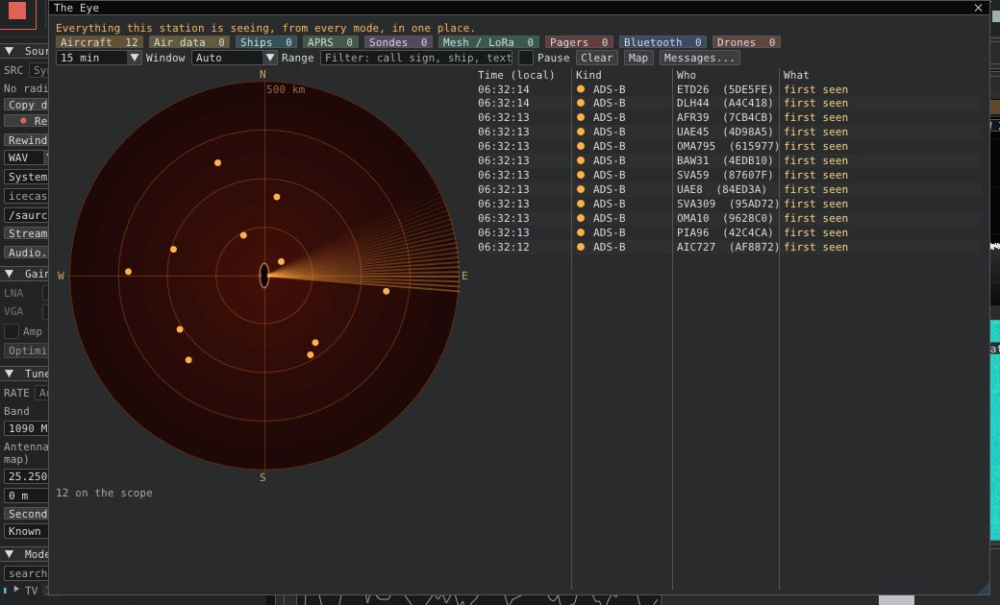

# The Eye

**Tools > The Eye** (or **Ctrl+E**) shows everything the station decodes, from every mode, in one window. It's useful when several receivers run at once, or when you want to know what is around you without opening each mode.

## What it shows

- **A chip per kind of contact:** Aircraft, Air data (ACARS, VDL2, HFDL), Ships (AIS, DSC), APRS, Sondes, Mesh / LoRa, Pagers, Bluetooth and Drones. Each shows how many contacts were heard in the chosen window. Click a chip to show only that kind; click it again to show everything.
- **The scope.** Every contact with a position, placed by bearing and distance from your receiver, with north up. The range is chosen to fit the farthest contact, or set it yourself (10 to 2000 km). Recent contacts are bright and older ones fade. Hover a dot for its name, distance, bearing and last message, and click it to pick it out in the timeline. The scope needs your location; set it in the ADS-B settings or with **Use as my location** on the map.
- **The timeline.** One line when a contact is heard for the first time, and one when it sends a message that differs from its last one. Position updates only move the dot, so an aircraft that reports every two seconds doesn't flood the list. Filter by call sign, ship name, address or words in the message. **Pause** holds the list still while you read it; the counts and the scope keep running.

## Where it comes from

The Eye listens to the same events as the automations and the message database (Tools > Messages...). It starts listening when the program starts, so opening the window shows what was heard before. It keeps the last 2000 timeline lines and 5000 contacts in memory and writes nothing to disk; use **Messages...** to search everything older.

Voice and encrypted content never reach it, the same rule as the message database.
